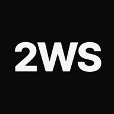
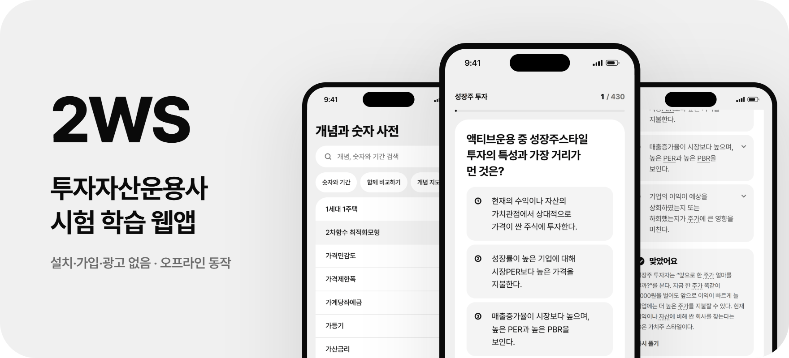
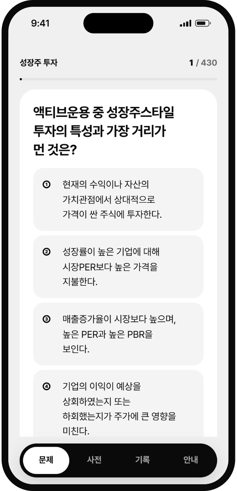
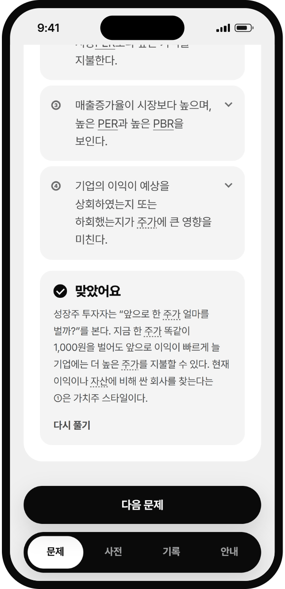
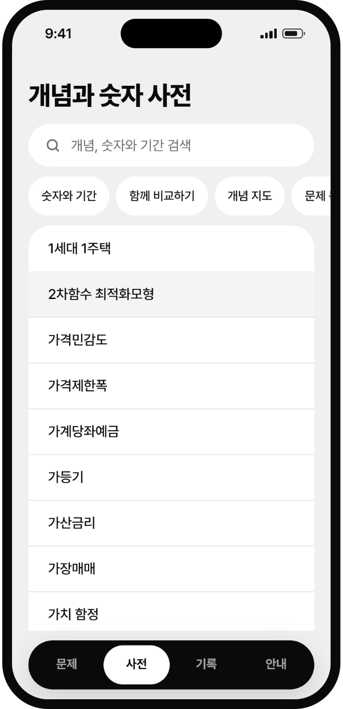
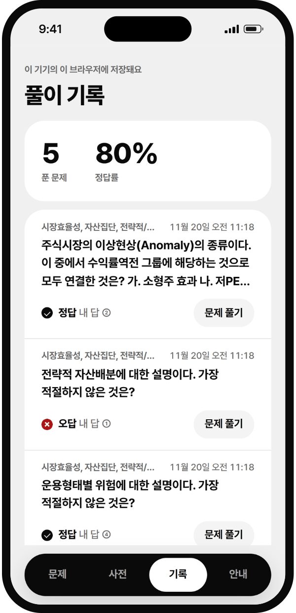
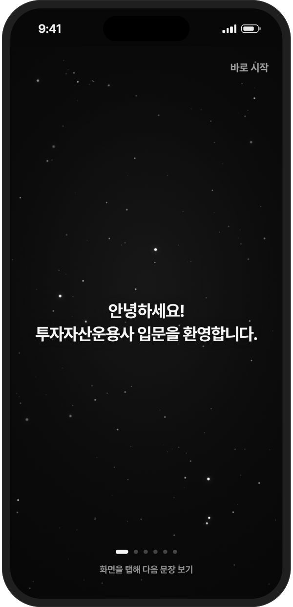

# 2WS

설치 없이 오프라인으로 공부하는 투자자산운용사 무료 웹앱입니다.

<picture>
  <source media="(prefers-color-scheme: dark)" srcset="docs/readme/hero-dark.png">
  <source media="(prefers-color-scheme: light)" srcset="docs/readme/hero-light.png">
  
</picture>

## 화면

<table>
  <tr>
    <td align="center" width="33%">
      <picture>
        <source media="(prefers-color-scheme: dark)" srcset="docs/readme/screens/quiz-dark.png">
        
      </picture>
       <b>문제 풀이</b> 4지선다·OX 풀이
    </td>
    <td align="center" width="33%">
      <picture>
        <source media="(prefers-color-scheme: dark)" srcset="docs/readme/screens/explain-dark.png">
        
      </picture>
       <b>해설</b> 풀이 직후 해설 확인
    </td>
    <td align="center" width="33%">
      <picture>
        <source media="(prefers-color-scheme: dark)" srcset="docs/readme/screens/dict-dark.png">
        
      </picture>
       <b>개념 사전</b> 주요 용어 찾아보기
    </td>
  </tr>
  <tr>
    <td align="center" width="33%">
      <picture>
        <source media="(prefers-color-scheme: dark)" srcset="docs/readme/screens/history-dark.png">
        
      </picture>
       <b>풀이 기록</b> 기기에만 저장되는 기록
    </td>
    <td align="center" width="33%">
      
       <b>환영 화면</b> 가벼운 인사로 시작
    </td>
    <td width="33%"></td>
  </tr>
</table>

## 소개

투자자산운용사 시험 공부를 위해 개인이 만들어 GitHub Pages로 공개한 무료·비영리 개인 학습용 웹앱입니다. 광고·결제·회원가입 없이 [https://keunhyeung.github.io/2ws/](https://keunhyeung.github.io/2ws/)에서 이용할 수 있으며, 상업적 이용을 금지합니다.

- 구성: 4지선다 430문항, OX 324문항, 용어 사전 1,792개, 개념 지도
- 풀이 기록: 사용자의 기기(브라우저) 안에만 저장되고 외부로 보내지 않습니다.

## 라이선스

| 구분 | 라이선스 | 안내 문서 |
| --- | --- | --- |
| 코드 | MIT | [LICENSE](LICENSE) |
| 데이터 (`data/`, `offline.html` 안의 데이터) | 허락하지 않음, 재배포 불가 | [data/NOTICE.md](data/NOTICE.md) |

- 운영자가 직접 만든 문항 외의 문항에 대한 저작권은 해당 원저작자에게 있으며, 일부 문항은 원저작자를 확인하지 못했을 수 있습니다.
- 운영자가 AI 도구를 활용해 정리한 해설·요약의 권리는 운영자에게 있으며, 데이터(문제·해설·용어)의 재배포는 불가합니다.

## 면책

- 금융투자협회, CFA Institute 등 어떤 기관과도 관계가 없고 보증·승인을 받지 않은 비공식 자료입니다.
- 문항 작성, 해설 작성, 내용 검토 모두에 AI 도구를 활용했으므로 오류가 있을 수 있습니다.
- 정확성을 보장하지 않습니다. 법령·세율·제도는 개정될 수 있으니 시험 준비와 실제 판단에는 법령 원문과 공식 교재를 확인해 주세요.
- 투자 권유·투자자문이 아니며, 학습 목적의 정보 제공을 위한 자료입니다.

## 상표

본 사이트와 저장소에 언급된 상표는 각 소유자의 것이며 식별 목적으로만 사용했습니다.

CFA®, Chartered Financial Analyst®, CIPM®, and GIPS® are registered trademarks owned by CFA Institute. CFA Institute does not endorse or promote this site, nor does it warrant the accuracy or quality of the content contained herein.

## 출처

해설과 용어 설명은 아래 공개 자료를 인용·참고해 운영자가 AI 도구를 활용해 정리한 요약이며, 앱 내 각 해설의 '출처 보기' 링크에서 원문을 확인할 수 있습니다. (확인 기준일: 2026-11-20)

- 국가법령정보센터([law.go.kr](https://www.law.go.kr)) 법령
- 금융투자협회 규정·안내
- CFA Institute 자료
- 국세청·금융위원회·한국은행·기획재정부·금융감독원 자료
- 한국거래소
- 미국 SEC([investor.gov](https://www.investor.gov)) 등 해외 공공기관
- 자산운용사 투자설명서·상품 안내

## 삭제·정정 요청

권리자임을 확인할 수 있는 자료와 해당 문항(문제 내용이나 화면 위치)을 [GitHub Issues](https://github.com/keunhyeung/2ws/issues)로 보내 주시면, 확인 후 지체 없이 비공개 또는 삭제하겠습니다.
